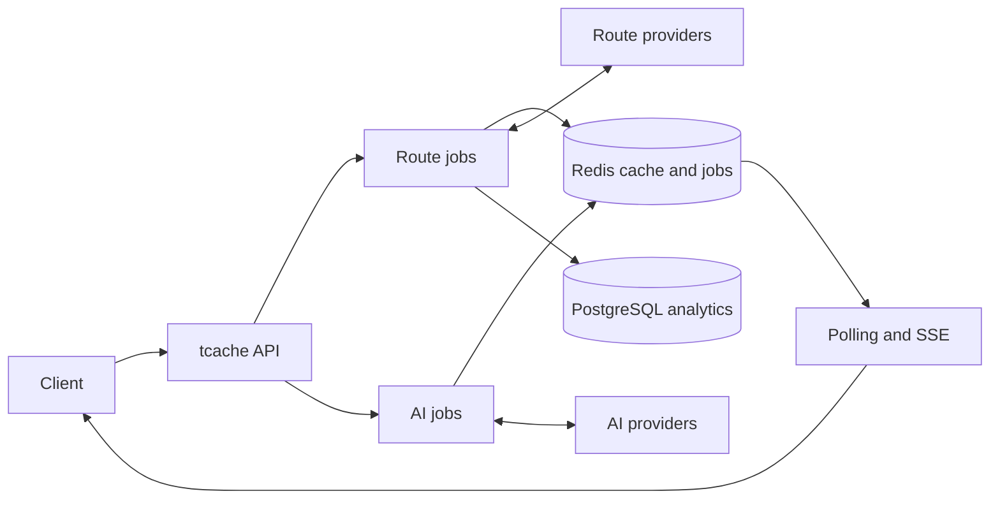

# tcache

tcache is a cache and job server for routing and AI APIs.

## Overview

Routing providers use different request formats, place identifiers, and
policies. AI calls have a similar problem: the caller should not have to manage
provider-specific requests, cache keys, or long-running connections.

tcache keeps that work in one service. It normalizes requests, selects a
provider, caches the result, and exposes the work as an asynchronous job.
Trasolve and troute both use tcache, but the service can run without either of
them.

## Features

- Cached route, travel-time matrix, and AI requests
- Redis-backed jobs with polling, SSE updates, and cancellation
- Route provider selection by country and travel mode
- PostgreSQL route-request analytics
- A local testbed for routes, matrices, AI jobs, cache entries, and status

## Providers

Route adapters currently included in the server:

| Provider              | Scope                                                   | Setup                                           |
| --------------------- | ------------------------------------------------------- | ----------------------------------------------- |
| Google Routes         | Driving, walking, cycling, and transit                  | `GOOGLE_MAPS_API_KEY`                           |
| Kakao Mobility / Maps | South Korea routing                                     | `KAKAO_MOBILITY_API_KEY`, `KAKAO_REST_API_KEY`  |
| Ekispert              | Japan transit; the default Japan transit provider       | `EKISPERT_API_KEY`                              |
| NAVITIME              | Japan transit                                           | `NAVITIME_API_KEY`                              |
| OpenTripPlanner       | Experimental Japan transit adapter; disabled by default | Self-hosted OTP and `OTP_PROVIDER_ENABLED=true` |
| Mock                  | Local development and tests                             | None                                            |

The AI side supports Gemini, OpenWebUI, and a mock provider. Gemini needs
`GEMINI_API_KEY`; OpenWebUI needs its base URL and a model name. Provider
failures do not fall back to another provider, and AI SSE events report job
progress rather than model tokens.

See [Configuration](docs/configuration.md) for provider capabilities, keys, and
selection rules.

## How It Works

A request is normalized and stored as a job. tcache checks Redis first and
calls the selected provider only on a cache miss. The result and final job
state are written back to Redis, where clients can poll them or receive updates
over SSE. Cancelling a running job aborts the active provider request.

Route and AI requests use separate cache namespaces and provider pipelines.
PostgreSQL stores route-request metadata for analytics; cache bodies and live
job state remain in Redis. Cache keys, TTLs, and job lifecycle details are
documented in [Configuration](docs/configuration.md) and the
[API Reference](docs/api.md).

## Getting Started

tcache requires Node.js 22 or later, pnpm 10.15.1, and Redis. Development uses
the mock providers by default, so no external API key is needed for the first
run. Follow [Getting Started](docs/getting-started.md) for local setup, Docker
Compose, and working API examples.

The server runs on <http://localhost:3200> and the testbed on
<http://localhost:3201> by default.

## Documentation

- [Getting Started](docs/getting-started.md)
- [API Reference](docs/api.md)
- [Configuration](docs/configuration.md)
- [Deployment](docs/deployment.md)
- [OpenTripPlanner Tokyo PoC](otp/README.md)
